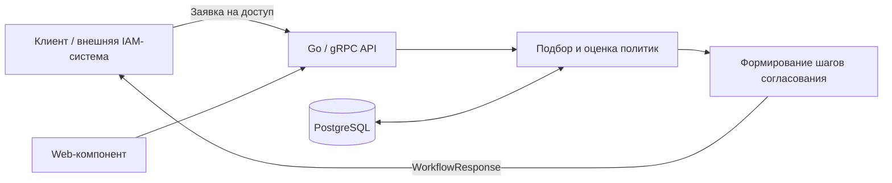

# IAM Workflow Router

**IAM Workflow Router** — учебно-исследовательский backend-проект на Go для автоматического построения маршрутов согласования заявок на доступ к корпоративным ресурсам.

Сервис принимает заявку, сопоставляет её с настроенными политиками и возвращает упорядоченные этапы согласования с возможными согласующими. Цель — отделить логику **определения маршрута** от систем, которые создают заявки, исполняют согласования и непосредственно выдают права доступа.

> **Статус:** прототип / исследовательский проект. Не является готовой к промышленной эксплуатации IAM-системой.

## Задача

В крупной организации порядок согласования зависит от того, **кто** запрашивает доступ, **к какому ресурсу**, **в какой среде** и **с какими правами**.

Например, при запросе доступа к производственной базе данных может потребоваться согласование руководителя, владельца ресурса и представителя службы информационной безопасности. Для других ресурсов и ролей маршрут будет отличаться.

Проект исследует, как описывать такие правила в виде политик и формировать маршрут автоматически, без жёсткого прописывания всей логики согласований в приложении.

## Возможности

- Приём заявок на доступ через **gRPC**.
- Формирование маршрута из последовательных шагов согласования.
- Поддержка нескольких согласующих на одном шаге и режимов **ANY / ALL**.
- Выбор и объединение политик с учётом их типа и приоритета.
- Условное включение шагов в зависимости от параметров заявки.
- Получение пояснения о том, какие политики были применены при обработке заявки.
- Проверка, входит ли пользователь в число согласующих для конкретного шага.
- Хранение данных политик в **PostgreSQL**.
- Отдельный веб-компонент для взаимодействия с сервисом.

## Как это работает



**Пример результата** (иллюстративный сценарий):

```text
Запрос: доступ к производственной базе данных

1. Руководитель подразделения       → ANY
2. Владелец ресурса                 → ANY
3. Информационная безопасность      → ALL
```

Каждый шаг содержит название, идентификаторы согласующих и режим согласования. Конкретный маршрут зависит от применимых политик и параметров заявки.

## Технологии

| Компонент | Технология |
| --- | --- |
| Backend | Go 1.24 |
| API | gRPC, Protocol Buffers |
| Хранилище | PostgreSQL 16, pgx |
| Запуск | Docker, Docker Compose |
| Дополнительно | Веб-компонент, SQL-миграции |

## gRPC API

Контракт описан в [`proto/iam/v1/iam.proto`](proto/iam/v1/iam.proto).

| Метод | Назначение |
| --- | --- |
| `IAM.CreateAccessRequest` | Построить маршрут согласования по заявке |
| `IAM.ExplainAccessRequest` | Получить информацию о рассмотренных политиках |
| `IAM.IsApprover` | Проверить, является ли пользователь согласующим на шаге |
| `HRService.GetHRInfo` | Контракт для получения информации о сотруднике |

В заявке передаются сведения об инициаторе и получателе доступа, ресурсе, ролях, окружении и других атрибутах. Ответ содержит последовательность `WorkflowStep`.

## Быстрый запуск

Понадобятся **Docker** и **Docker Compose**.

```bash
git clone https://github.com/Yasprut/nir.git
cd nir

cp .env.example .env
# Проверьте настройки .env перед запуском

docker compose up --build -d
```

Согласно `docker-compose.yml`, локально публикуются:

- `localhost:50051` — gRPC-сервис;
- `http://localhost:8080` — веб-компонент;
- `localhost:5433` — PostgreSQL (порт хоста).

Остановить окружение:

```bash
docker compose down
```

> Учётные данные в `.env.example` предназначены только для локального тестирования. Перед развёртыванием в другой среде задайте собственные секреты и параметры подключения.

## Структура репозитория

```text
cmd/             # Точки входа приложений
internal/        # Внутренняя логика сервиса
migrations/      # SQL-миграции
pkg/dsl/         # Работа с описанием политик
proto/iam/v1/    # Контракт gRPC / Protocol Buffers
Dockerfile
docker-compose.yml
```

## Границы проекта

Сервис **строит маршрут согласования**, но не претендует на реализацию полного цикла управления доступом: аутентификации, выдачи прав, исполнения всех этапов согласования и администрирования внешних систем. Эти функции могут выполняться другими компонентами IAM-инфраструктуры.

Проект создан для практического изучения backend-разработки на Go, проектирования gRPC API, работы с базой данных и реализации бизнес-правил для корпоративных сценариев.
